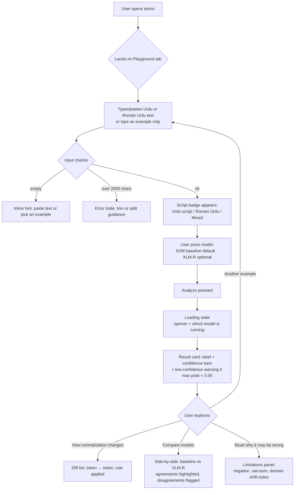
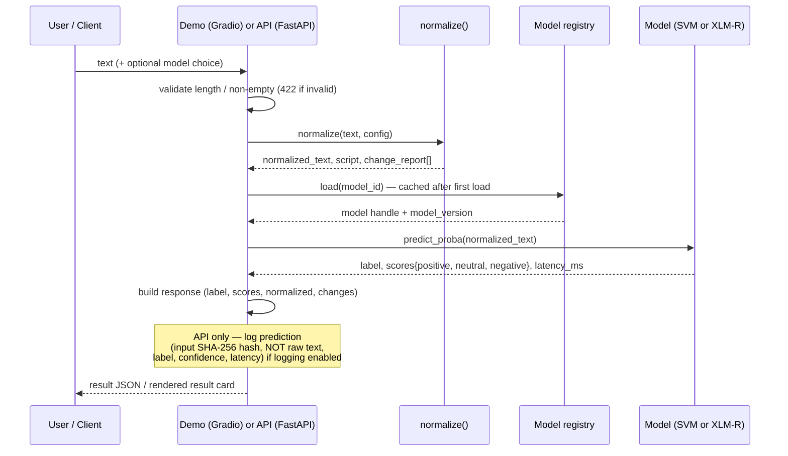
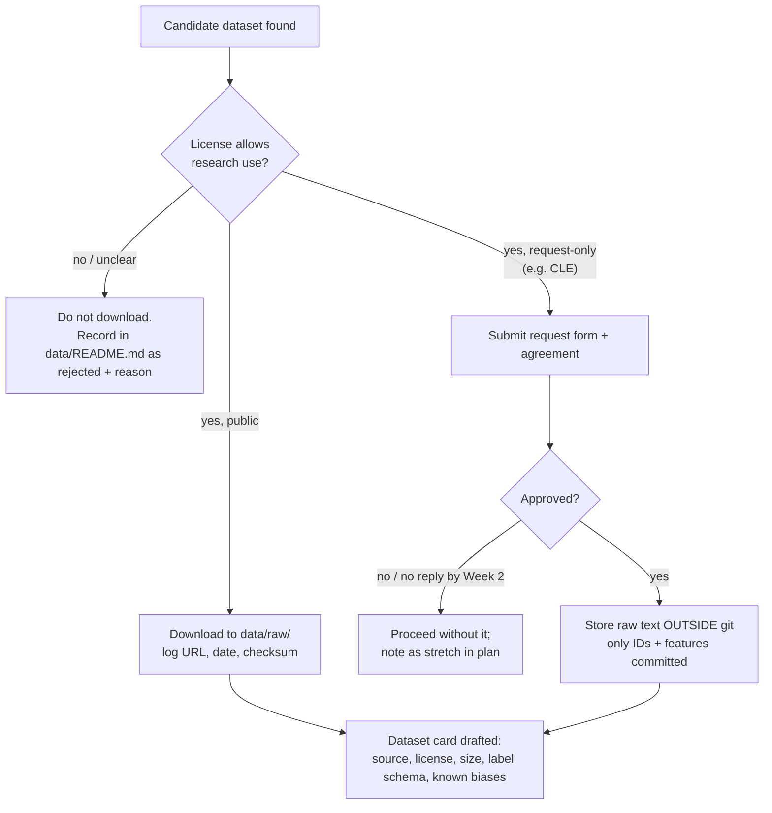

# FLOW — UrduNLP Toolkit

User flows (demo), request/data flow at prediction time, and the offline
training/evaluation flow. Diagrams are Mermaid; they render on GitHub and in
most Markdown previews.

## 1. Demo user flow

Key points:
- The script badge appears *before* analysis (on text change) — it teaches the
  user that the pipeline treats the two scripts differently.
- Disagreement between models is a feature, not a bug: the comparison view
  exists so visitors see honest uncertainty instead of one confident answer.

## 2. Prediction data flow (library + API)

## 3. Training & evaluation flow (offline)

```mermaid
flowchart LR
    A[Dataset sources<br/>Kaggle / HF public sets<br/>CLE request-only] --> B[Ingest + provenance log<br/>source, license, date, checksum]
    B --> C[Clean + label mapping<br/>to pos/neu/neg schema]
    C --> D[Dedup check<br/>near-duplicates forced<br/>into same split]
    D --> E[Fixed split seed 42<br/>train 80 / dev 10 / test 10<br/>IDs committed]
    E --> F1[Train classical<br/>TF-IDF + LogReg / SVM]
    E --> F2[Fine-tune XLM-R<br/>early stop on dev macro-F1]
    F1 --> G[Evaluate on test<br/>identical split for all models]
    F2 --> G
    G --> H[results/metrics.json<br/>+ confusion matrices]
    G --> I[Error slices<br/>negation · sarcasm · code-switch]
    I --> J[Error analysis notebook<br/>15-20 examples, tagged taxonomy]
    H --> K[README results table<br/>+ HF model card<br/>generated from metrics.json]
    J --> K
```

Rules enforced by this flow:
- No model is ever evaluated on a split it trained on; the split is generated
  once, before any training run.
- The README table and the Hugging Face model card are *generated from*
  `results/metrics.json` — they cannot drift from the measured numbers.
- Test labels are never edited after results are seen; suspected label noise
  is documented, not silently fixed.

## 4. Dataset acquisition flow (licensing gate)

